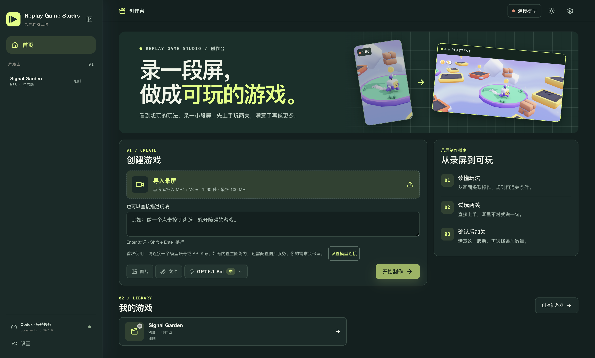

# Replay Game Studio

Replay Game Studio is a macOS desktop app for making a playable game from a short gameplay recording or a text idea. It builds on [Innate Labs' Noobi.ai](https://github.com/Innate-Labs/Noobi.ai).

[简体中文](README.zh-CN.md)



## What you can do

- Drop in an MP4 or MOV recording. Review the extracted controls, rules, and goal before building if you want to check the interpretation.
- Play the first two levels and describe any changes in the project conversation. Once you confirm the gameplay, choose 5, 10, or 20 additional levels.
- Connect using a ChatGPT/Codex account, an OpenAI, DeepSeek, or Alibaba Cloud Model Studio API key, or a Kimi account through Kimi CLI. Use your own account or key.

## Run from source

Install Node.js 22 LTS with npm on macOS, then run the following from the project directory:

```sh
npm ci
npm run dev
```

The project pins Codex CLI 0.167.0. In **Settings → Model Connections**, sign in or save and test an API key. Kimi users also need [Kimi CLI](https://www.kimi.com/code/docs/kimi-code-cli/guides/getting-started). Set up an image provider under **Media API** if your connection lacks built-in image generation.

For recording import, install FFmpeg and FFprobe with `brew install ffmpeg` and choose a model that accepts images. Recordings can be 1–60 seconds and up to 100 MB. Godot projects require Godot 4 with matching Web export templates.

Run `npm run verify` for type checking, tests, and a production build. Generated game projects are saved locally.

Local tests cover the desktop workflow and a sample game. Live recording analysis has been verified. In the live test, image generation failed and the first two-level build did not complete, so expansion was not verified end to end.

## Credits

The desktop game-production foundation comes from [Innate Labs' Noobi.ai](https://github.com/Innate-Labs/Noobi.ai). Replay Game Studio adds recording analysis, the two-level review and expansion workflow, multi-provider connections, and a redesigned workbench. The example gameplay image is from [Kenney's Starter Kit 3D Platformer](https://github.com/KenneyNL/Starter-Kit-3D-Platformer). See [the asset notice](docs/KENNEY-NOTICE.txt).
