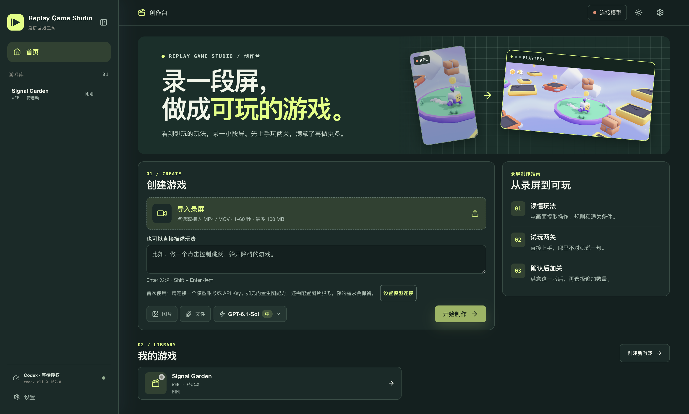

# Replay Game Studio

看到一段想玩的游戏画面，可以录屏导入 Replay Game Studio。先做两关试玩，哪里不满意就用对话描述。确认玩法后，再选择追加关卡。

[English](README.md)



## 从源码运行

在 macOS 上安装 Node.js 22 LTS 和 npm。在项目目录运行：

```sh
npm ci
npm run dev
```

首次打开后，进入「设置 → 模型连接」，使用 ChatGPT/Codex 账号、OpenAI／DeepSeek／阿里云百炼 API Key，或通过 [Kimi CLI](https://www.kimi.com/code/docs/kimi-code-cli/guides/getting-started) 登录 Kimi。项目依赖已锁定 Codex CLI 0.167.0。没有内置图片生成能力的连接需要在「媒体 API」配置图片服务。

导入录屏需要 FFmpeg 和 FFprobe，可以用 `brew install ffmpeg` 安装。录屏支持 MP4 和 MOV，时长 1–60 秒，最大 100 MB。分析录屏时需要可接收图片输入的模型。使用 Godot 时，需要 Godot 4 及相同版本的 Web 导出模板。

## 创建游戏

1. 导入录屏或直接描述玩法。上传后可以先核对操作、规则和通关条件。
2. 试玩前两关，在制作对话里反馈操作、难度或关卡问题。
3. 满意后点击「确认玩法」，再选择追加 5、10 或 20 关。

运行 `npm run verify` 可执行类型检查、测试和生产构建。生成的游戏工程保存在本地。

本地测试已覆盖桌面操作和示例游戏试玩，真实模型也已验证能读懂录屏。真实制作测试因图片生成失败，未完成两关交付，确认后追加尚待端到端验证。

## 来源

桌面游戏制作基座来自 [Innate Labs 的 Noobi.ai](https://github.com/Innate-Labs/Noobi.ai)。Replay Game Studio 在其基础上加入了录屏理解、两关试玩和确认后追加、多厂商模型连接，以及新版界面。首页示例画面来自 [Kenney 的 Starter Kit 3D Platformer](https://github.com/KenneyNL/Starter-Kit-3D-Platformer)。[素材许可说明](docs/KENNEY-NOTICE.txt)
